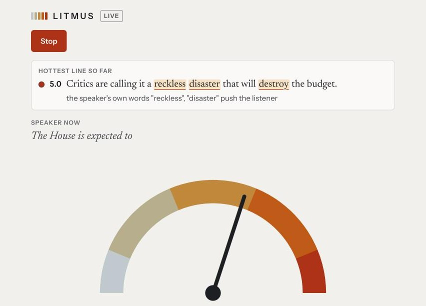
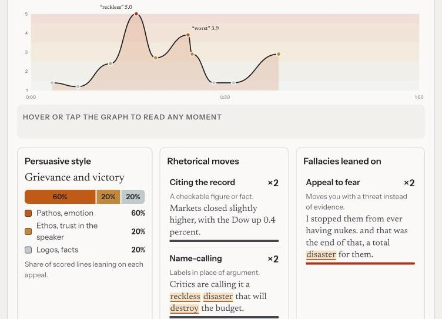

# LITMUS Live

A live meter for broadcast speech. It listens to a speech, a debate or a newscast and moves a needle from Proportionate to Hyperbolic, one sentence at a time. When you stop listening, it writes a report on the whole speech.

It is the spoken-word companion to [LITMUS](https://github.com/blueandyellow44/litmus), a news reader that scores every story for how it is told. The meter uses the same scale and the same rubric, adapted for one sentence of speech.



## What it does

The meter scores how something is said. It never scores the position the speaker takes, and it never rules on whether a claim is true. A calm sentence from either side reads the same on the needle.

Three rules carry most of the judgment.

- The speaker is scored on their own words. When a speaker repeats what someone else said, those words do not count against the speaker.
- A serious subject is not hyperbole. Describing a disaster plainly scores low.
- Greetings, asides and broken fragments carry no claim, so they are left out and do not drag the needle toward calm.

While you listen, the words doing the pushing are underlined, and the hottest line so far stays pinned at the top with the reason for its score.



The report charts the heat of the speech over time, names its persuasive style, and lists the rhetorical moves and fallacies the speaker leaned on, each with the line it came from.

The scoring is imperfect. A model reads each sentence with a few lines of context, and it will sometimes misjudge a misheard name or a sentence cut in half. The design choices below exist to keep those misses small and visible.

## How it works

```
tab or microphone audio -> 16 kHz PCM -> Deepgram streaming -> sentence builder
    -> Claude Haiku, one call per sentence -> needle, underlines, report
```

1. The browser captures audio from a Chrome tab or a microphone and converts it to 16 kHz PCM in an audio worklet.
2. The audio streams to Deepgram over a WebSocket. The browser opens it with a token that lasts 30 seconds, minted by the server, so the Deepgram key never reaches the page.
3. Interim transcripts fill the "Speaker now" line and are never scored. Finished sentences go to the server one at a time.
4. The server asks Claude Haiku 4.5 for a score, a reason and labels through a forced tool call. Requests run in parallel and the answers are placed in spoken order.
5. The needle shows the average of the two most recent scored sentences.
6. At the end, the model judges the whole transcript on five dimensions and the server computes the final number in code. The model never picks the number.

It runs on Cloudflare Pages with Pages Functions and one KV key. There is no database and no server to keep awake.

## Engineering notes

**A spend cap that fails closed.** Every paid call is counted. The server reads token usage from each Claude response, including responses it throws away as malformed, and counts Deepgram minutes from what the browser reports. At $40 the page shows a warning. At $50 the server refuses to mint tokens or score. A corrupt stored total returns an error and never reads as zero. KV allows one write per second per key, so charges are batched into one write every 1.5 seconds, and the cap check includes charges not yet written.

**Keys stay on the server.** The page is behind a passcode. The session cookie is an expiry time signed with HMAC, so the server holds no session state and changing the passcode ends every session. The passcode check runs in constant time.

**A stub mode for free local work.** With `STUB_MODE=1` the server fakes Deepgram and Claude with realistic delays, usage numbers and an occasional malformed answer, and the page plays a scripted broadcast through the real pipeline. Stub mode is refused on any host other than localhost. The screenshots above come from it.

**Tests.** 92 tests cover the sentence builder, the scoring guards, the spend cap, the session cookie and the wording of the rubric. `npm test` type-checks and runs them.

**Decisions are written where they apply.** Comments in the code record why a rule exists and the live test that produced it, so a later change does not quietly undo it.

## Cost

Prices checked 2026-10-07.

| Item | Rate | Source |
|---|---|---|
| Deepgram Nova-3 English streaming, pay as you go | $0.0077 per minute | https://deepgram.com/pricing |
| Claude Haiku 4.5 | $1 per million input tokens, $5 per million output | https://platform.claude.com/docs/en/about-claude/pricing |

An hour of listening costs about $2.50, measured on the deployed meter. Deepgram is about $0.46 of that. Scoring is about $0.0035 a sentence, and broadcast speech runs near ten sentences a minute. The report adds about a cent. Rates live in `server/prices.ts`.

## Run it locally

```sh
npm install
cp .dev.vars.example .dev.vars   # set METER_PASSCODE and STUB_MODE=1
npm test
npm run dev                      # http://127.0.0.1:8788
```

Stub mode makes no paid calls. Tick "Show lag" to see the time from a finished transcript to the screen for each sentence.

## Deploy your own

```sh
./scripts/create-project.sh      # creates the Pages project and the KV namespace
npx wrangler pages secret put DEEPGRAM_API_KEY --project-name litmus-meter
npx wrangler pages secret put ANTHROPIC_API_KEY --project-name litmus-meter
npx wrangler pages secret put METER_PASSCODE --project-name litmus-meter
npm run deploy
```

The Deepgram key needs Member permission to mint tokens. The spend cap needs the Workers Paid plan, because the meter writes to KV about 600 times an hour and the free plan allows 1,000 writes a day.

## Layout

- `server/` holds the API. `rubric.ts` is the scale and the prompt, `score.ts` and `verdict.ts` are the guards around the model, `spend.ts` is the cap.
- `src/` holds the page. `lib/sentences.ts` builds sentences from transcripts and `lib/pipeline.ts` keeps answers in order.
- `functions/` is the Pages Functions entry point.
- `design/` holds the mockups the interface was chosen from.
- `tests/` holds the tests.

## License

MIT. See [LICENSE](LICENSE).
